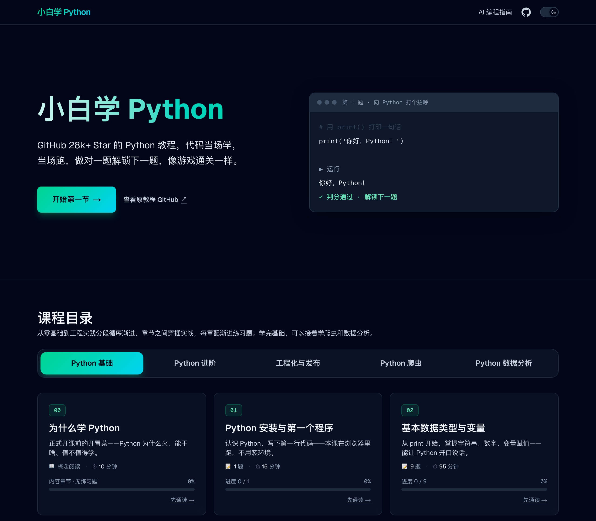
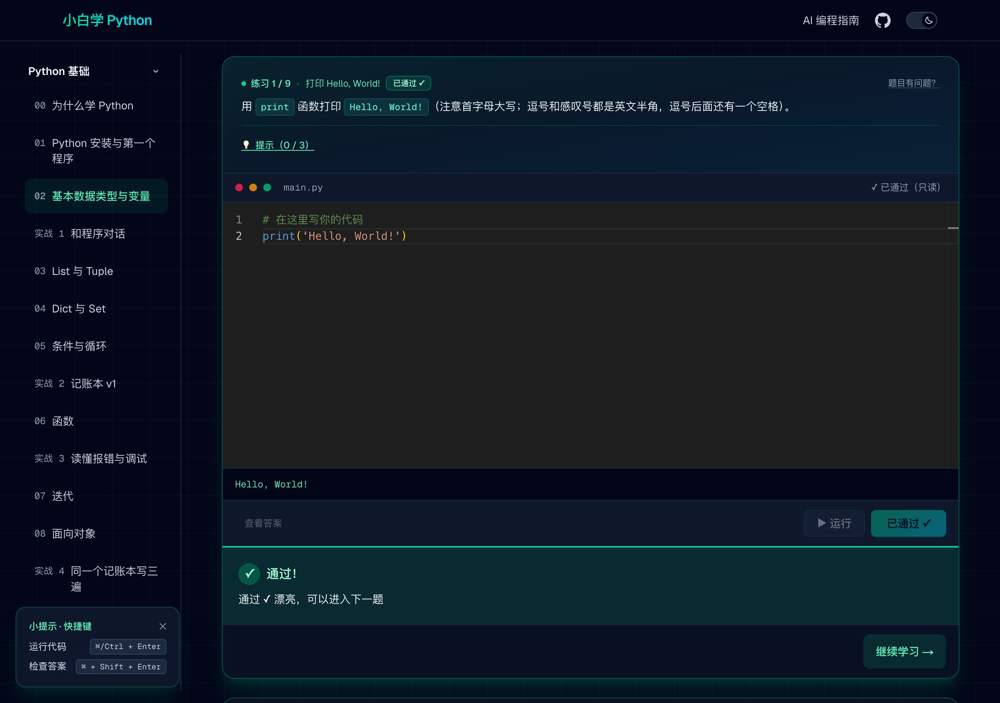

# 小白学 Python

> 在线闯关学习网站：**[learn-py.org](https://learn-py.org/)**（本开源库教程网页版，浏览器直接运行代码，阅读学习体验更好）

IT 行业相对于一般传统行业，发展更新速度更快，一旦停止学习，很快就会被行业淘汰。但我们要清楚：淘汰的永远只是初级水平的从业者，技术过硬的人永远都是稀缺的。因此对于学习，还是要踏踏实实的。

自学 Python 也是一样，不要一开始头脑发热就到处收藏资料网站、买一堆书、下载大量教学视频，过了几天热情褪去，再过几个星期，终于完成了《从入门到放弃》。其实市面上的教程都大差不差，我们新手学习，最重要的是选定一个教程，一步一个脚印，踏踏实实地练。

## 2026 更新说明

这套教程写于 2017 年，不知不觉已经过了九年。九年间，这个仓库收获了近 3 万 Star，至今每天还保持着几十个 Star 的增长，非常夸张。

2026 年是 AI Agent 元年。这一年我深切感受到 AI 的强大，以前手敲代码的年代正在一去不复返，现在手敲代码甚至被称为「古法编程」。按「AI 一天，人间一年」的发展速度，未来大量数字工作都会被 AI 重塑甚至替代。所以我都以为这套 Python 课程不会再有人看了，没想到它依然每天稳定增长，收到的好评也多到让我意外。

但如果你问我还要不要深入学习 Python 的语法和使用，我还是建议，AI 时代不需要深入学，建议全面拥抱 AI ，AI 就是确定性的未来，AI 时代学编程跟我们以前手敲代码学编程是完全不一样的。当然如果这是你接触的第一门编程语言，你是可以快速过一下这个教程的，了解下 Python 的一些语法，体验下编程语言的设计和编程思维，总会有收获的。

基于这个教程收到的很多好评，心里还是开心的，所以十年没写过新的教程了，今年准备写一个 AI 教程，有兴趣的可以关注下，也可以加我微信学习交流，加入微信群，微信：thinktoday2019 。

最后，我也顺手用 AI 做了一个更方便大家学习的网站：**[learn-py.org](https://learn-py.org/)**。为了省成本，它是一个纯静态网站，该有的功能和体验都有，只是学习记录保存在本地浏览器，没法跨设备同步。

这是一个像升级打怪一样学 Python 的网站：不用配环境，打开浏览器就能写代码、当场跑、判分秒回，做对一题解锁下一题。截两张图给大家感受下：

**首页**：按学习阶段分为五大课程，自动记录你的学习进度。

**课程练习**：每学完一个知识点就有配套练习题，在线写代码提交，通过即解锁下一节内容。

对初学者来说体验会非常好，快去试试吧，也欢迎推荐给身边的朋友，记得点个 star。

## 课程目录

全套教程按学习路径分为五个部分，每章一个 Markdown 文件，配合 [datasets](./datasets/README.md) 数据集与 [examples](./examples/study_tracker/README.md) 综合示例，可直接按顺序阅读与运行。

### 一、Python 基础

零基础入门到面向对象与模块，章节之间穿插 6 节实战，用记账本串起全套语法。

* [第 0 章：为什么学 Python？](./tutorials/01-basics/00-why-python.md)
* [Python 代码规范](./tutorials/01-basics/00b-code-specification.md)
* [第 1 章：第一个 Python 程序](./tutorials/01-basics/01-hello-world.md)
* [第 2 章：基本数据类型和变量](./tutorials/01-basics/02-data-types-and-variables.md)
* [实战 1：和程序对话](./tutorials/01-basics/02b-practice-1-talk-to-program.md)
* [第 3 章：List 和 Tuple](./tutorials/01-basics/03-list-and-tuple.md)
* [第 4 章：Dict 和 Set](./tutorials/01-basics/04-dict-and-set.md)
* [第 5 章：条件语句和循环语句](./tutorials/01-basics/05-conditions-and-loops.md)
* [实战 2：记账本 v1](./tutorials/01-basics/05b-practice-2-ledger-v1.md)
* [第 6 章：函数](./tutorials/01-basics/06-functions.md)
* [实战 3：读懂报错与调试](./tutorials/01-basics/06b-practice-3-debugging.md)
* [第 7 章：迭代器和生成器](./tutorials/01-basics/07-iteration.md)
* [第 8 章：面向对象](./tutorials/01-basics/08-oop.md)
* [实战 4：同一个记账本写三遍](./tutorials/01-basics/08b-practice-4-ledger-rewrite.md)
* [第 9 章：模块与包](./tutorials/01-basics/09-modules.md)
* [实战 5：文件、csv 与 json](./tutorials/01-basics/09b-practice-5-files-csv-json.md)
* [实战 6：自学一个新模块](./tutorials/01-basics/09c-practice-6-learn-a-module.md)

### 二、Python 进阶

深入理解 Python 高级机制与现代语法特性。

* [第 10 章：Python 的 Magic Method](./tutorials/02-advanced/10-magic-methods.md)
* [第 11 章：枚举类](./tutorials/02-advanced/11-enum.md)
* [第 12 章：元类](./tutorials/02-advanced/12-metaclass.md)
* [第 13 章：线程与进程](./tutorials/02-advanced/13-threading.md)
* [第 14 章：一步一步了解正则表达式](./tutorials/02-advanced/14-regex.md)
* [第 15 章：闭包](./tutorials/02-advanced/15-closure.md)
* [第 16 章：装饰器](./tutorials/02-advanced/16-decorator.md)
* [第 17 章：类型注解](./tutorials/02-advanced/17-type-hints.md)
* [第 18 章：pathlib 路径处理](./tutorials/02-advanced/18-pathlib.md)
* [第 19 章：异常处理与异常组](./tutorials/02-advanced/19-exception-handling.md)
* [第 20 章：dataclass 与 Pydantic](./tutorials/02-advanced/20-dataclass.md)
* [第 21 章：上下文管理器](./tutorials/02-advanced/21-context-manager.md)
* [第 22 章：async/await 与并发](./tutorials/02-advanced/22-async.md)

### 三、工程化与发布

用现代工具链组织、规范、测试并发布你的 Python 项目。

* [第 23 章：工程基线 pyproject 与 uv](./tutorials/03-engineering/23-pyproject-uv.md)
* [第 24 章：代码风格 ruff](./tutorials/03-engineering/24-ruff.md)
* [第 25 章：单元测试 pytest](./tutorials/03-engineering/25-pytest.md)
* [第 26 章：标准日志 logging](./tutorials/03-engineering/26-logging.md)
* [第 27 章：打包发布与 typer](./tutorials/03-engineering/27-pypi.md)
* [第 28 章：学完之后做什么](./tutorials/03-engineering/28-whats-next.md)

### 四、Python 爬虫

前置要求：学完「Python 基础」。从 HTTP 请求、HTML 解析到登录态与动态页面，配在线练习书店靶场。

* [第 1 章：爬虫能做什么、不能做什么](./tutorials/04-crawler/01-crawler-intro.md)
* [第 2 章：一次请求发生了什么](./tutorials/04-crawler/02-http-request.md)
* [第 3 章：看懂 HTML，会用开发者工具](./tutorials/04-crawler/03-html-and-devtools.md)
* [第 4 章：BeautifulSoup 基础](./tutorials/04-crawler/04-beautifulsoup-basics.md)
* [第 5 章：从列表页提取多条数据](./tutorials/04-crawler/05-extract-list.md)
* [第 6 章：翻页与礼貌地爬](./tutorials/04-crawler/06-pagination-and-politeness.md)
* [第 7 章：数据藏在接口里](./tutorials/04-crawler/07-json-api.md)
* [第 8 章：存下来：csv、json 与 sqlite3](./tutorials/04-crawler/08-save-data.md)
* [第 9 章：综合项目：爬完整个书店](./tutorials/04-crawler/09-bookstore-project.md)
* [第 10 章：回到自己电脑：本地环境与练习网站](./tutorials/04-crawler/10-local-requests.md)
* [第 11 章：Session 与 Cookie：登录以后再抓](./tutorials/04-crawler/11-session-and-cookies.md)
* [第 12 章：动态页面与并发](./tutorials/04-crawler/12-dynamic-and-concurrency.md)

### 五、Python 数据分析

前置要求：学完「Python 基础」。使用 `pandas` 与 `matplotlib` 完成数据清洗、汇总、可视化与分析报告（配套数据见 [datasets/](./datasets/README.md) ）。

* [第 1 章：数据分析在做什么](./tutorials/05-data-analysis/01-what-is-analysis.md)
* [第 2 章：认识 DataFrame](./tutorials/05-data-analysis/02-first-dataframe.md)
* [第 3 章：挑出想要的数据](./tutorials/05-data-analysis/03-selecting-data.md)
* [第 4 章：用几个数说清一列](./tutorials/05-data-analysis/04-descriptive-stats.md)
* [第 5 章：把数据洗干净](./tutorials/05-data-analysis/05-data-cleaning.md)
* [第 6 章：分组汇总与透视表](./tutorials/05-data-analysis/06-groupby-and-pivot.md)
* [第 7 章：把几张表拼起来](./tutorials/05-data-analysis/07-merge-and-concat.md)
* [第 8 章：把数字画成图](./tutorials/05-data-analysis/08-charts.md)
* [第 9 章：综合项目一：分析一年的记账本](./tutorials/05-data-analysis/09-ledger-analysis.md)
* [第 10 章：综合项目二：给书店写一份分析报告](./tutorials/05-data-analysis/10-bookstore-report.md)

持续更新……

可以关注我的公众号，实时了解本仓库与后续 AI 教程的更新动态：

## License

教程内容（markdown / 代码示例 / 图片）以 [CC BY 4.0](LICENSE) 协议授权。

© 2017–2026 [walter201230](https://github.com/walter201230)。任何人可以自由分享和改编，仅需署名原作者

## Star History

<a href="https://www.star-history.com/?repos=walter201230%2FPython&type=date&legend=top-left">
  <picture>
    <source media="(prefers-color-scheme: dark)" srcset="https://api.star-history.com/svg?repos=walter201230/python&type=Date&theme=dark" />
    <source media="(prefers-color-scheme: light)" srcset="https://api.star-history.com/svg?repos=walter201230/python&type=Date" />
    
  </picture>
</a>

