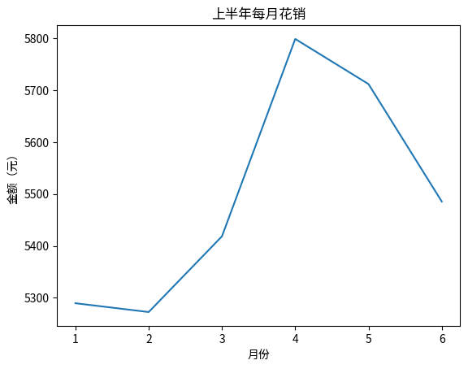
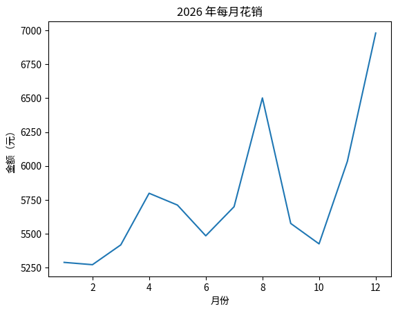
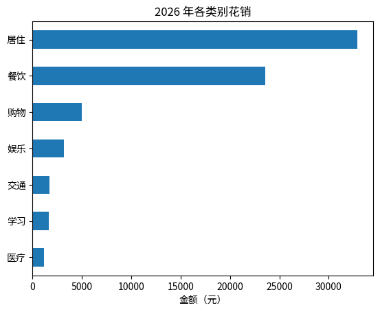
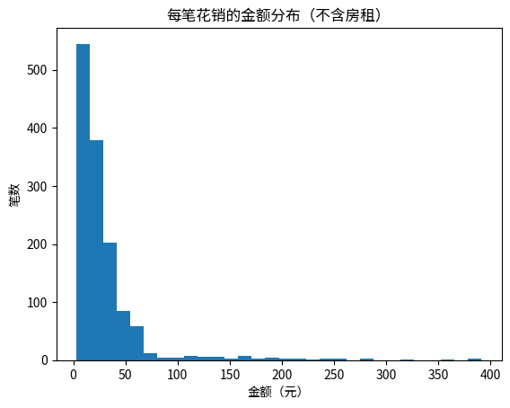
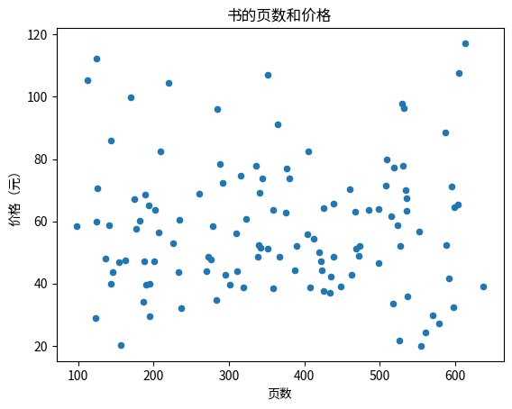
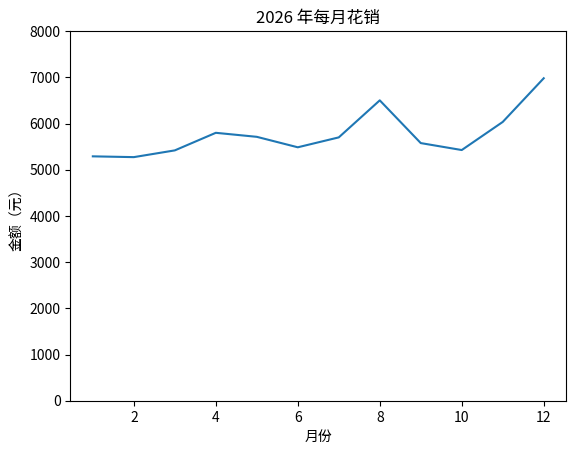
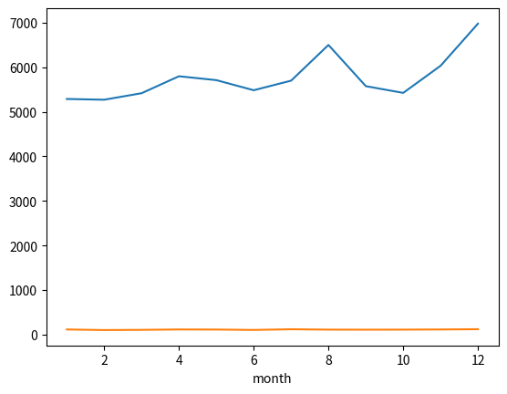
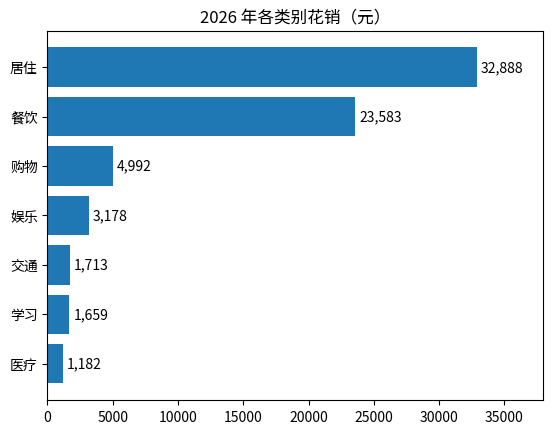

# 数据分析第 8 章：把数字画成图

# 前言

第 6 章里，咱们算出了每个月花了多少，结果是 12 个数排成的一列。可要想知道哪个月最多、是不是越花越多，就得一个一个地比着看，挺费劲的。

有没有更直观的办法呢？有：把这些数画成一张折线图，一眼就看出来了。

所以说，画图不是为了好看，而是为了**让数据自己说话**。走势、多少、分布、关系，这些在表格里要费劲比较的东西，画到图上，一眼就能看到。而且分析做完以后，要把结论讲给别人听，一张好图也比一页数字管用。

那拿什么来画呢？Python 里画图最常用的工具是 **matplotlib** 。pandas 的表和列，也能直接调用它来画。和 pandas 一样，它在网页里已经准备好了，代码运行以后，图会显示在输出区里。

**学这一章之前**，需要先学完 [数据分析课第 7 章](07-merge-and-concat.md) 。

# 目录

这一章会学到：

- 一、第一张图——`plt.plot()`
- 二、用 pandas 画——折线图和柱状图
- 三、看分布——直方图
- 四、看关系——散点图，以及什么问题用什么图
- 五、常见坑
- 六、自己查一次文档——给柱子标上数
- 七、小结与回看

学完这一章，算出来的结果，你都能把它画成一张清楚、不骗人的图。

# 一、第一张图

matplotlib 到底怎么用呢？咱们先不碰 pandas，就拿两个列表，画一张最简单的图。数据用的是第 6 章算出来的上半年每月花销：

```python
import matplotlib.pyplot as plt

months = [1, 2, 3, 4, 5, 6]
totals = [5289.5, 5272.5, 5418.5, 5799.0, 5712.0, 5485.5]

plt.plot(months, totals)
plt.title('上半年每月花销')
plt.xlabel('月份')
plt.ylabel('金额（元）')
plt.show()
```

运行后，画出来的图是这样的：



这段代码虽然短，用到的却都是画图最基本的几步。咱们一行一行地看：

- `import matplotlib.pyplot as plt` ：matplotlib 里管画图的部分叫 `pyplot` ，大家都习惯把它简写成 `plt` ，就像 pandas 简写成 `pd` 一样。
- `plt.plot(横坐标, 纵坐标)` ：两个列表一样长，一个对一个，连成一条线。第一个点是（1, 5289.5），第二个点是（2, 5272.5）……
- `plt.title()` 、`plt.xlabel()` 、`plt.ylabel()` ：分别设置图的标题、横轴的名字和纵轴的名字。
- `plt.show()` ：把图显示出来。

为什么非要写标题和坐标轴的名字呢？因为一张图至少要让人看懂三件事：画的是什么（标题），横着是什么、竖着是什么（坐标轴的名字）。少了哪一个，看图的人都得靠猜。

再说说 `plt.show()` 。在网页里，它写不写都行，因为运行结束后，画好的图都会显示在输出区。可在自己电脑上就不一样了：它会弹出一个窗口显示这张图，关掉窗口以后，程序才会接着往下走。

还有一点：图上的中文能正常显示，也是因为网页里已经设置好了中文字体。在自己电脑上，还得多写两行，第五节会讲到。

用列表画图，数据得自己一个一个抄进去。可咱们的数据本来就在 pandas 的表里，能不能直接拿来画呢？下一节就来看。

# 二、用 pandas 画

能不能直接拿 pandas 里的数据来画呢？当然能。数据在 pandas 里的时候，就不用再自己准备列表了。因为 Series 有一个 `plot()` 方法，它会拿索引当横坐标，拿值当纵坐标，直接画出来。这回把全年的 12 个月都画上：

```python
import pandas as pd
import matplotlib.pyplot as plt

ledger = pd.read_csv('ledger_2026.csv')
ledger['month'] = pd.to_datetime(ledger['date']).dt.month
monthly = ledger.groupby('month')['cost'].sum()

monthly.plot(title='2026 年每月花销')
plt.xlabel('月份')
plt.ylabel('金额（元）')
plt.show()
```



这段代码里，有三点值得说一说：

- `monthly` 的索引是 1 到 12 月，值是每个月的合计，正好一个当横坐标，一个当纵坐标。
- `title` 可以直接写在 `plot()` 的括号里。
- 横轴、纵轴的名字，还是用 `plt` 来设置。这是因为 pandas 的 `plot()` 背后就是 matplotlib，所以两个可以混着用。

再看图，一眼就能看出来：上半年比较平，8 月冒了一个头，到了年底，11 月、12 月一路往上走。这正是第 6 章从一列数字里费劲找出来的结论。

折线图适合看**随时间的变化**。那要是想比较几个类别谁多谁少呢？这时候就该用柱状图了。下面用 `kind='barh'` 画横着的柱子，这样类别的名字也是横着写的，不会挤在一起：

```python
import pandas as pd
import matplotlib.pyplot as plt

ledger = pd.read_csv('ledger_2026.csv')
totals = ledger.groupby('category')['cost'].sum().sort_values()

totals.plot(kind='barh', title='2026 年各类别花销')
plt.xlabel('金额（元）')
plt.ylabel('')
plt.show()
```



这段代码里，也有三个地方要说一下：

- `kind` 决定画什么图：`'line'` 是折线图，也是默认的；`'bar'` 是竖着的柱状图；`'barh'` 是横着的柱状图。
- 先用 `sort_values()` 从小到大排好序，横着画的时候，最大的就在最上面，一眼就能看出排名。
- `plt.ylabel('')` 是去掉纵轴的名字。因为类别的名字已经写在每根柱子旁边了，再写一个「category」就多余了。

最后还要记住一点：柱状图里，柱子的**长短**就代表多少，所以柱子一定要从 0 开始画。好在 pandas 和 matplotlib 默认就是这样画的。

先做一道练习：按付款方式把金额加起来，画成一张横向柱状图。

# 三、看分布：直方图

折线图看变化，柱状图比多少。那如果想看一列数是怎么分布的呢？还记得第 4 章问过的那个问题吗：平时一笔花多少钱？当时的答案，是用中位数、分位数这几个数来说的。而直方图，能把这个问题**画**出来：

```python
import pandas as pd
import matplotlib.pyplot as plt

ledger = pd.read_csv('ledger_2026.csv')
no_rent = ledger[ledger['item'] != '房租']

no_rent['cost'].plot(kind='hist', bins=30, title='每笔花销的金额分布（不含房租）')
plt.xlabel('金额（元）')
plt.ylabel('笔数')
plt.show()
```



直方图是怎么画出来的呢？它先把金额从小到大分成 30 段，`bins=30` 说的就是分几段；然后每一段里有几笔，就画多高的柱子。

这和第 4 章用 `value_counts(bins=...)` 分段数个数，是同一个意思，只不过这回画成了图。那这张图该怎么读呢？看两处就行：

- 柱子集中在最左边：说明绝大多数花销都在几十元以内。
- 往右拖着一条长长的「尾巴」：零零星星有几笔一两百、三四百元的，是衣服、看病、网课这些。

这种「大多数很小、少数很大」的样子，正是平均数会被拉高、中位数更靠谱的原因。你看，几个数说不太清楚的形状，一张直方图就看明白了。

那 `bins` 分多少段才合适呢？分得太少，细节都被抹平了；分得太多，每段只有零星几笔，看上去坑坑洼洼的。所以可以多试几个数，选一个最能看清形状的。

先做一道练习：把书的价格画成直方图，看看它是怎么分布的。

# 四、看关系：散点图

前面的几张图，看的都是一列数。可有时候，咱们想知道的是两列数之间有没有关系。比如两点书店里，页数多的书，是不是更贵？像这样两列数之间的**关系**，就要用散点图来看。画的时候，DataFrame 的 `plot()` 要用 `x` 、`y` 说明拿哪两列来画：

```python
import pandas as pd
import matplotlib.pyplot as plt

books = pd.read_csv('books.csv')
books.plot(kind='scatter', x='pages', y='price', title='书的页数和价格')
plt.xlabel('页数')
plt.ylabel('价格（元）')
plt.show()
```



图上的每个点，就是一本书：横着看是页数，竖着看是价格。

那怎么看出有没有关系呢？要是页数越多越贵，点就会从左下往右上，排成一条斜斜的带子。可这张图上，点散得满满当当，看不出任何方向：同样是两三百页的书，有便宜的，也有贵的。

所以结论是：**在两点书店，页数和价格没什么关系**。

有的童鞋可能会觉得：画了半天，什么都没发现，白画了。其实不是。没发现关系，也是一个结论，它能帮你排除一个想当然的猜测：想知道书为什么贵，就得去别的列里找原因了。

到这里，已经画过四种图了。那什么时候该用哪一种呢？要按你想回答的问题来选，可以对照这张表：

| 想看什么 | 用什么图 | `kind=` | 这一章的例子 |
|---|---|---|---|
| 随时间的变化 | 折线图 | `'line'` | 每月花销 |
| 几个类别比多少 | 柱状图 | `'bar'` 、`'barh'` | 各类别花销 |
| 一列数的分布 | 直方图 | `'hist'` | 每笔花销的金额 |
| 两列数的关系 | 散点图 | `'scatter'` | 页数和价格 |

记住这个顺序：先想清楚问题，再选图，而不是先挑一种好看的图，再往里塞数据。

# 五、常见坑

图会画了，可从「画得出来」到「画得清楚、不骗人」，中间还有几个坑。下面这三个，刚开始画图时很容易碰到。

## 1、在自己电脑上，中文变成了方块

要是在自己电脑上运行这一章的代码，标题和坐标轴上的中文，很可能会变成一个个小方块。同时还会冒出一串「Glyph …… missing from current font」这样的警告，意思是字体里找不到这个字。

为什么会这样呢？因为 matplotlib 默认用的字体里没有汉字。所以解决起来也简单，告诉它换一个有汉字的字体就行。在 `import matplotlib.pyplot as plt` 下面加上这两行：

<!-- skip-ci -->
```python
plt.rcParams['font.sans-serif'] = ['Microsoft YaHei', 'PingFang SC', 'Noto Sans CJK SC']
plt.rcParams['axes.unicode_minus'] = False
```

这两行各做了什么呢？一个一个来看：

- `rcParams` 是 matplotlib 的设置，用起来像一个字典。
- `font.sans-serif` 是字体的候选名单，按顺序找，找到哪个就用哪个。这里写了三个：Windows 自带的微软雅黑、macOS 自带的苹方，以及 Linux 上常见的思源黑体。
- `axes.unicode_minus` 设成 `False` ，是因为有的中文字体里没有专门的负号，坐标轴上的负数会变成方块。

在网页里运行就不用操心了：网站已经替你做了同样的设置，用的是思源黑体，所以不用写这两行。

## 2、纵轴的起点，会改变图给人的感觉

回头看看第二节的每月折线图，纵轴是从 5000 多开始的。所以 12 月的点高高地翘在上面，看上去好像比 1 月多花了好几倍。可实际上，12 月是 6980 元，1 月是 5289.5 元，只多了三成左右。

那要是让纵轴从 0 开始，会是什么样子呢？再画一次看看：

```python
import pandas as pd
import matplotlib.pyplot as plt

ledger = pd.read_csv('ledger_2026.csv')
ledger['month'] = pd.to_datetime(ledger['date']).dt.month
monthly = ledger.groupby('month')['cost'].sum()

monthly.plot(title='2026 年每月花销', ylim=(0, 8000))
plt.xlabel('月份')
plt.ylabel('金额（元）')
plt.show()
```



这里的 `ylim=(0, 8000)` ，规定了纵轴从 0 画到 8000。你看，同样的数据，起伏一下子平缓多了。

那这两张图，哪一张画错了呢？其实两张都没有画错，只是强调的东西不一样：前一张放大了变化，适合看细节；这一张保留了比例，适合看多少。所以，给别人看图的时候，要想一想纵轴的起点会不会让人误会。柱状图就更不用说了，柱子一定要从 0 开始，不然长短就失去了意义。

## 3、两张图画到了一起

下面这段代码，本想画两张图：一张是每月花了多少钱，一张是每月记了几笔。

```python
import pandas as pd
import matplotlib.pyplot as plt

ledger = pd.read_csv('ledger_2026.csv')
ledger['month'] = pd.to_datetime(ledger['date']).dt.month
ledger.groupby('month')['cost'].sum().plot()
ledger.groupby('month').size().plot()
plt.show()
```



结果呢，两条线挤在了一张图上。一条在五六千，另一条在一百上下，几乎贴在了底下，根本看不清。

为什么会画到一起呢？因为 matplotlib 默认是往「当前这张图」上画的，不会自动新开一张。所以要画第二张图，得先用 `plt.figure()` 新开一张：

```python
import pandas as pd
import matplotlib.pyplot as plt

ledger = pd.read_csv('ledger_2026.csv')
ledger['month'] = pd.to_datetime(ledger['date']).dt.month
ledger.groupby('month')['cost'].sum().plot(title='每月花销（元）')
plt.figure()
ledger.groupby('month').size().plot(title='每月笔数')
plt.show()
```

这样就成了两张图，各管各的纵轴。

所以要记住：单位不一样的两组数，不要硬塞进同一张图。钱和笔数，一个几千、一个一百上下，放在一起，总有一个会被压扁。

坑看完了，先做一道练习：数出每个月记了几笔，再画成折线图。

# 六、自己查一次文档

再回头看看第二节的横向柱状图。谁多谁少，一眼就能看出来；可每根柱子到底是多少钱，就只能对着横轴的刻度去估了。那能不能把数直接标在柱子旁边呢？

这件事，matplotlib 的文档里正好有一个函数管，名字就叫「给柱子贴标签」：[matplotlib.pyplot.bar_label](https://matplotlib.org/3.8.4/api/_as_gen/matplotlib.pyplot.bar_label.html) 。

打开文档，第一句话说的就是它的用途：给柱状图加标签。接着往下看，参数有这几个：

- `container` ：一组柱子，「很可能是 `bar` 或 `barh` 返回的」。
- `fmt` ：数字的格式，默认是 `'%g'` 。3.7 版以后，也可以写 `{}` 风格的格式。
- `padding` ：标签离柱子末端有多远。

另外，文档还提醒了一句：可能需要调整坐标轴的范围，好让标签放得下。这句话先记着，一会儿就用得上。

参数看完了，该怎么用呢？`container` 要的是「`barh` 返回的东西」。所以这回不用 pandas 的 `plot()` 了，直接用 `plt.barh()` 来画，再把它返回的柱子存起来：

```python
import pandas as pd
import matplotlib.pyplot as plt

ledger = pd.read_csv('ledger_2026.csv')
totals = ledger.groupby('category')['cost'].sum().sort_values()

bars = plt.barh(totals.index, totals.values)
plt.bar_label(bars, fmt='{:,.0f}', padding=3)
plt.xlim(0, 38000)
plt.title('2026 年各类别花销（元）')
plt.show()
```



这段代码里，有四个地方要说一下：

- `plt.barh(名字, 长度)` ：`totals.index` 是类别，`totals.values` 是金额。
- `fmt='{:,.0f}'` ：和 f-string 里的格式一样，`,` 是每三位加一个逗号，`.0f` 是不要小数。
- `padding=3` ：在标签和柱子之间留一点空。
- `plt.xlim(0, 38000)` ：把横轴放长一些，这样最长那根柱子的标签才放得下。这就是文档提醒的那件事。

标上了数，看图的人就不用再估了。不过，数也不要标得太多：一张图上每个点都写着数，反而什么都看不清。像这种柱子不多的柱状图，标上数正合适。

回过头再看，文档里那句「可能需要调整坐标轴的范围」，看起来不起眼，却正好说中了第一次用它时会碰到的问题。所以读文档的时候，这种提醒值得多留意。

# 七、小结与回看

这一章，咱们把前面算出来的数字，画成了一张张图。回头梳理一下，学到了这几件事：

- 画图的基本几步：`import matplotlib.pyplot as plt` ；`plt.plot(横坐标, 纵坐标)` 画折线，`plt.title()` 、`plt.xlabel()` 、`plt.ylabel()` 写上标题和坐标轴的名字，`plt.show()` 把图显示出来。
- pandas 的 Series、DataFrame 都有 `plot()` ，`kind` 决定画什么图：`'line'` 是折线图，`'bar'` 、`'barh'` 是柱状图，`'hist'` 是直方图，`'scatter'` 是散点图。
- 按问题选图：看变化用折线图，比多少用柱状图，看分布用直方图，看两列数的关系用散点图。
- 常见的坑有三个：自己电脑上中文变方块，要用 `rcParams` 设置中文字体；纵轴的起点会改变图给人的感觉，柱子一定要从 0 开始；画第二张图前，要用 `plt.figure()` 新开一张，单位不同的数不要挤在一起。
- 查文档学会了用 `plt.bar_label()` 给柱子标上数，再用 `plt.xlim()` 给标签留出地方。

哪里卡住了，就回去看一看：

- f-string 的格式：第 2 章
- 按月汇总：数据分析课第 6 章

到这里，数据分析要用的本事就都学全了：读进来、看清楚、挑出来、洗干净、算一算、拼起来、画出来。学全了以后，接下来做什么呢？下一章，咱们把这些本事串在一起，从头到尾分析一年的记账本，最后写成一份完整的报告。
