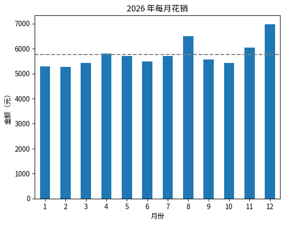

# 数据分析第 9 章：综合项目一：分析一年的记账本

# 前言

八章学下来，读进来、看清楚、挑出来、洗干净、算一算、拼起来、画出来，做数据分析的零件都已经齐了。零件齐了，能拼出什么来呢？这一章不学新东西，就用这些零件做一个完整的分析，回答一个问题：**2026 年这一年的钱，花得怎么样？**

还记得第 1 章说的六个步骤吗？提问、获取、清洗、探索、分析、结论。前面每一章，练的都只是其中的一两步；这一章，咱们要从头走到尾。

具体怎么走呢？和爬虫课的综合项目一样，节奏是这样的：先把问题拆清楚，再一个问题一个问题地算；每算出一个数，都检查一下对不对；最后，把结论写成一份别人看得懂的报告。

**学这一章之前**，需要先学完数据分析课第 1～8 章，尤其是 [第 6 章](06-groupby-and-pivot.md) 的分组汇总和 [第 8 章](08-charts.md) 的画图。

# 目录

这一章会做：

- 一、提问——把「花得怎么样」拆成五个具体的问题
- 二、获取和检查——写一个 `load()` 函数
- 三、一共花了多少，花在哪儿
- 四、哪几个月花得多，为什么
- 五、吃饭和周末
- 六、写成一份报告
- 七、常见坑
- 八、自己查一次文档——用 `pct_change()` 算比上个月多了多少
- 九、小结与回看

做完这一章，你会有一份从数据里一步步推出来、每个数都经得起追问的分析报告。

# 一、提问

「今年的钱花得怎么样？」这个问题，能直接拿数据来回答吗？其实不能，因为它太笼统了，不知道该算什么。第 1 章说过，碰到这种问题，要先把它变成一个个**能用数据回答的具体问题**。

那该怎么拆呢？可以拆成下面这五个：

| 问题 | 要算的数 | 用到的本事 |
|---|---|---|
| 1. 一年一共花了多少，平均每月多少？ | 总额、月平均 | `sum()` |
| 2. 钱主要花在哪儿？ | 各类别的金额和占比 | `groupby()` 、比例 |
| 3. 哪几个月花得多？多在哪儿？ | 每月金额，每月各类别金额 | `dt.month` 、`pivot_table()` 、画图 |
| 4. 吃饭花了多少？三顿饭里哪顿最该省？ | 三餐的笔数、合计、平均 | 筛选、`agg()` |
| 5. 周末是不是比工作日花得多？ | 周末、工作日每天平均花多少 | `dt.dayofweek` 、分组 |

你看，拆完以后，每个问题要算什么数、用哪个方法，就都清楚了。

不过，拆问题的时候，还有两件事值得想一想：

- **这份数据能回答吗？** 比如「钱花得值不值」，账本里没有收入，也不知道每样东西买得开不开心，就回答不了。只有能答的，才放进清单。
- **答出来有什么用？** 比如问题 4、5，都指向同一件事：要是想省钱，该从哪儿下手。所以问题不是越多越好，每一个都要能帮你做决定。

问题拆好了，接下来就照着这张表，一个一个地算。不过在算之前，得先把数据读进来，看看它靠不靠得住。

# 二、获取和检查

五个问题，每一个都要先读进记账本，再把日期变成真正的日期。同样的几行代码，与其每次都写一遍，不如把它们写成一个函数：

```python
import pandas as pd


def load(path):
    """读进记账本，加上月份、是否周末两列"""
    ledger = pd.read_csv(path)
    ledger['date'] = pd.to_datetime(ledger['date'])
    ledger['month'] = ledger['date'].dt.month
    ledger['weekend'] = ledger['date'].dt.dayofweek >= 5
    return ledger


ledger = load('ledger_2026.csv')
print(ledger.head(3))
```

输出的结果：

```
        date      item category    cost payment  month  weekend
0 2026-01-01      房租     居住  2500.0  银行卡      1    False
1 2026-01-01  水电燃气     居住   156.0  支付宝      1    False
2 2026-01-01      早饭     餐饮    13.0  支付宝      1    False
```

函数里除了读文件、转日期，还多加了两列，都是给后面的问题准备的：

- `month` 是月份，问题 3 要用。
- `weekend` 用的是第 5 章学的 `dt.dayofweek` ：5 是星期六，6 是星期日，大于等于 5 就是周末。比较的结果，是一串 `True` 和 `False` 。问题 5 要用到它。

数据读进来了，可先别急着算。第 5 章说过，拿到数据的第一件事，是给它做个体检：

```python
import pandas as pd


def load(path):
    """读进记账本，加上月份、是否周末两列"""
    ledger = pd.read_csv(path)
    ledger['date'] = pd.to_datetime(ledger['date'])
    ledger['month'] = ledger['date'].dt.month
    ledger['weekend'] = ledger['date'].dt.dayofweek >= 5
    return ledger


ledger = load('ledger_2026.csv')
print(len(ledger), ledger.isna().sum().sum(), ledger.duplicated().sum())
print(ledger['date'].min(), ledger['date'].max(), ledger['date'].nunique())
print(ledger['cost'].min(), ledger['cost'].max())
```

输出的结果：

```
1354 0 0
2026-01-01 00:00:00 2026-12-31 00:00:00 365
3.0 2500.0
```

三行输出，咱们一行一行地看：

- 第一行：一共 1354 笔，没有空值，也没有重复的行。这里的 `isna().sum()` 算出的是每一列的空值个数，再 `sum()` 一次，就是整张表一共有几个空值。
- 第二行：日期从 1 月 1 日到 12 月 31 日，一共 365 个不同的日子。也就是说，每天都记了账，没有漏掉的日子。
- 第三行：金额最少 3 元，最多 2500 元，那是房租。没有负数，也没有离谱的值。

体检下来，这份账本是干净的，可以放心地分析了。要是体检发现了问题，就该先用第 5 章的办法，把数据洗干净再说。

另外，把读数据写成 `load()` 函数，还有一个好处：明年有了 `ledger_2027.csv` ，只要换一个文件名，后面的分析一行都不用改。

数据准备好了，下一节就从最基本的两个问题算起。

# 三、一共花了多少，花在哪儿

先算问题 1 和问题 2：一年一共花了多少？钱主要花在哪儿？这两个问题都要用到全年的总额，所以放在一起算：

```python
import pandas as pd


def load(path):
    """读进记账本，加上月份、是否周末两列"""
    ledger = pd.read_csv(path)
    ledger['date'] = pd.to_datetime(ledger['date'])
    ledger['month'] = ledger['date'].dt.month
    ledger['weekend'] = ledger['date'].dt.dayofweek >= 5
    return ledger


ledger = load('ledger_2026.csv')
total = ledger['cost'].sum()
print(f'全年合计 {total:,.1f} 元，平均每月 {total / 12:,.1f} 元')

by_category = ledger.groupby('category')['cost'].sum().sort_values(ascending=False)
share = (by_category / total).round(3)
print(share)
print(share.sum())
```

输出的结果：

```
全年合计 69,195.5 元，平均每月 5,766.3 元
category
居住    0.475
餐饮    0.341
购物    0.072
娱乐    0.046
交通    0.025
学习    0.024
医疗    0.017
Name: cost, dtype: float64
1.0
```

代码里有两处值得说一说：

- `by_category / total` ：一个 Series 除以一个数，每个值都会除一遍，得到的就是各类别的占比。注意，它和第 4 章的 `value_counts(normalize=True)` 不一样：那个是按**笔数**算的比例，这里是按**金额**算的。
- 最后打印 `share.sum()` ，是顺手做个检查：占比加起来应该是 1。这回正好是 1.0，没有多也没有少。每算出一组数，都找一个办法验一验，这是这一章要养成的习惯。

数都验过了，可以下结论了：

- 一年花了将近 7 万元，平均每月五千七百多元。
- **居住占了将近一半**，47.5%。房租、水电这些是固定开销，每个月都得交，短期内很难省下来。
- **吃饭占了三分之一**，34.1%。剩下的购物、娱乐、交通、学习、医疗，加起来还不到两成。

这告诉我们：真想省钱，能动的主要就是吃饭和购物这两块。

知道了钱花在哪儿，下一节接着看钱是什么时候花的：哪几个月花得多？在那之前，先做一道练习，算一算吃饭和购物这两块一共占了多少。

# 四、哪几个月花得多，为什么

接下来是问题 3：哪几个月花得多？多在哪儿？

说一个月花得「多」，是和谁比呢？和全年的月平均比。所以先把每个月的合计画出来，再画一条全年平均的横线，放在一起比一比：

```python
import pandas as pd
import matplotlib.pyplot as plt


def load(path):
    """读进记账本，加上月份、是否周末两列"""
    ledger = pd.read_csv(path)
    ledger['date'] = pd.to_datetime(ledger['date'])
    ledger['month'] = ledger['date'].dt.month
    ledger['weekend'] = ledger['date'].dt.dayofweek >= 5
    return ledger


ledger = load('ledger_2026.csv')
monthly = ledger.groupby('month')['cost'].sum()
average = monthly.mean()
print(round(average, 2))
print(monthly[monthly > average])

monthly.plot(kind='bar', title='2026 年每月花销', rot=0)
plt.axhline(average, color='gray', linestyle='--')
plt.xlabel('月份')
plt.ylabel('金额（元）')
plt.show()
```

输出的结果：

```
5766.29
month
4     5799.0
8     6501.5
11    6034.5
12    6980.0
Name: cost, dtype: float64
```



这段代码里，有三个地方要说一下：

- `monthly[monthly > average]` ：这是第 3 章学的按条件挑，对 Series 也一样能用。
- `rot=0` 让横轴上的月份正着写，不要歪着。
- `plt.axhline(数值)` 在这个高度画一条横线，`color` 是颜色，`linestyle='--'` 表示画成虚线。

再看结果，比平均高的有四个月。不过 4 月只比平均多了三十几元，算是持平。明显偏高的，是 8 月、11 月和 12 月。

那这三个月，多花在哪儿了呢？第 6 章的透视表就能回答。这次把居住和餐饮拿掉，只看那些「不是每个月都有」的类别：

```python
import pandas as pd


def load(path):
    """读进记账本，加上月份、是否周末两列"""
    ledger = pd.read_csv(path)
    ledger['date'] = pd.to_datetime(ledger['date'])
    ledger['month'] = ledger['date'].dt.month
    ledger['weekend'] = ledger['date'].dt.dayofweek >= 5
    return ledger


ledger = load('ledger_2026.csv')
table = ledger.pivot_table(index='month', columns='category', values='cost', aggfunc='sum', fill_value=0)
print(table[['购物', '学习', '医疗']].loc[[8, 11, 12]])
print(table[['购物', '学习', '医疗']].mean().round(1))
```

输出的结果：

```
category    购物   学习   医疗
month                         
8          852.5  500.0    0.0
11         577.0  164.0  216.5
12        1173.0  142.5  363.5
category
购物    416.0
学习    138.2
医疗     98.5
dtype: float64
```

输出分成两部分：前一部分是这三个月的购物、学习、医疗，后一部分是这三类全年每月的平均。两部分对着看：

- 8 月：购物 852.5 元，是平时的两倍；学习 500 元，是平时的三倍多。
- 11 月：购物、医疗都比平时多。
- 12 月：购物 1173 元，将近平时的三倍；医疗也多了两百多。

所以，花得多的月份，并不是每天都多花了一点，而是**有几笔大的购物、学习、看病**。尤其是购物，三个偏高的月份都少不了它。

那为什么 8 月、12 月买得多呢？是赶上了促销，还是换季添衣服？账本里没有写，所以数据回答不了。分析能告诉你「多在哪儿」，至于「为什么」，有时还得去问记账的人。

先做一道练习：反过来，把花得比平均少的月份挑出来。

# 五、吃饭和周末

## 1、三顿饭

第三节算出来，吃饭占了全年花销的三分之一，是能省钱的一大块。那么问题 4 就来了：三顿饭各花了多少？哪顿最该省？

```python
import pandas as pd


def load(path):
    """读进记账本，加上月份、是否周末两列"""
    ledger = pd.read_csv(path)
    ledger['date'] = pd.to_datetime(ledger['date'])
    ledger['month'] = ledger['date'].dt.month
    ledger['weekend'] = ledger['date'].dt.dayofweek >= 5
    return ledger


ledger = load('ledger_2026.csv')
meals = ledger[ledger['item'].isin(['早饭', '午饭', '晚饭'])]
print(meals.groupby('item')['cost'].agg(['count', 'sum', 'mean']).round(2))

dinner = meals[meals['item'] == '晚饭']
expensive = dinner[dinner['cost'] > 50]
print(len(expensive), expensive['cost'].sum())
```

输出的结果：

```
      count     sum   mean
item                      
午饭    326  8605.5  26.40
早饭    255  2716.0  10.65
晚饭    231  9143.5  39.58
55 3030.5
```

先看三顿饭的对比。晚饭吃的次数最少，231 次，花的钱却最多，9143.5 元，平均一顿将近 40 元。再看最后一行：晚饭里超过 50 元的有 55 顿，加起来三千多元，占了晚饭的三分之一。

顺便还能看出一件事：一年 365 天，早饭只记了 255 次。也就是说，有一百多天要么没吃早饭，要么忘了记。

所以结论是：三顿饭里，**晚饭最值得省**，尤其是那些超过 50 元的。少吃几顿贵的晚饭，比每天在早饭上省一两元管用得多。

## 2、周末和工作日

吃饭说完了，再来看问题 5：周末是不是比工作日花得多？

这里要比的，是「每天」花多少。所以得先把每一天的花销加起来，再按是不是周末分组，求平均。另外，还有一件事要先处理：房租都在每月 1 号交，而 1 号是星期几，完全是碰巧的，会把比较搅乱。所以先把居住这一类拿掉：

```python
import pandas as pd


def load(path):
    """读进记账本，加上月份、是否周末两列"""
    ledger = pd.read_csv(path)
    ledger['date'] = pd.to_datetime(ledger['date'])
    ledger['month'] = ledger['date'].dt.month
    ledger['weekend'] = ledger['date'].dt.dayofweek >= 5
    return ledger


ledger = load('ledger_2026.csv')
daily_items = ledger[ledger['category'] != '居住']
daily = daily_items.groupby(['date', 'weekend'])['cost'].sum().reset_index()
print(daily.head(3))
print(daily.groupby('weekend')['cost'].agg(['count', 'mean', 'median']).round(2))
```

输出的结果：

```
        date  weekend  cost
0 2026-01-01    False  86.0
1 2026-01-02    False  59.0
2 2026-01-03     True  55.5
         count    mean  median
weekend                       
False      261   91.90   76.00
True       104  118.46   98.25
```

这段代码里，最值得说的是「按天加起来」的那一步：

- `groupby(['date', 'weekend'])` ：按两列分组，把日期和是不是周末一起分。其实同一天的周末标记都一样，带上它，是为了加完以后这一列还在。
- `reset_index()` 把分组的两列放回表里，这是第 6 章讲过的。现在一行就是一天：哪天、是不是周末、这天花了多少。

有了每天的花销，再按是不是周末分组，求每天的平均和中位数。结果是：周末 104 天，平均每天花 118.46 元；工作日 261 天，平均每天 91.90 元。中位数也是周末高。

所以结论是：**周末每天比工作日多花二十多元**，多了三成左右。一年有 104 个周末日，加起来就是两千多元。

那多出来的钱，花在哪儿了呢？是周末吃得更好，还是出去玩了？光看这个数还说不清，得按类别拆开再比。下面的练习，就先拆出吃饭这一块。算完看看，和你猜的一样不一样。

# 六、写成一份报告

到这里，五个问题都有了答案。还剩最后一步：把它们写成一份别人看得懂的报告。

那报告该怎么写呢？不是把所有算出来的数都堆上去，而是按这个顺序来：**先说结论，再给数字，最后说清楚局限**。而且，报告里的数字也不用手抄，而是用程序算出来、用 f-string 填进去。这样以后数据变了，重新运行一遍，报告就跟着更新了。

```python
import pandas as pd


def load(path):
    """读进记账本，加上月份、是否周末两列"""
    ledger = pd.read_csv(path)
    ledger['date'] = pd.to_datetime(ledger['date'])
    ledger['month'] = ledger['date'].dt.month
    ledger['weekend'] = ledger['date'].dt.dayofweek >= 5
    return ledger


ledger = load('ledger_2026.csv')
total = ledger['cost'].sum()
by_category = ledger.groupby('category')['cost'].sum()
monthly = ledger.groupby('month')['cost'].sum()
high_months = monthly[monthly > monthly.mean() * 1.03].index.tolist()
dinner = ledger[ledger['item'] == '晚饭']['cost']
daily = ledger[ledger['category'] != '居住'].groupby(['date', 'weekend'])['cost'].sum().reset_index()
per_day = daily.groupby('weekend')['cost'].mean()

print('2026 年记账本分析')
print('=' * 20)
print(f'1. 全年花了 {total:,.1f} 元，平均每月 {total / 12:,.1f} 元。')
print(f"2. 居住占 {by_category['居住'] / total:.1%}，餐饮占 {by_category['餐饮'] / total:.1%}，能省的主要是吃饭和购物。")
print(f'3. 花得多的月份是 {high_months} 月，多出来的主要是购物、学习和看病。')
print(f'4. 晚饭平均一顿 {dinner.mean():.1f} 元，超过 50 元的有 {(dinner > 50).sum()} 顿，最值得省。')
print(f'5. 不算居住，周末每天花 {per_day[True]:.1f} 元，工作日 {per_day[False]:.1f} 元。')
print('说明：数据只有一年，没有收入，也不知道每笔花销的原因。')
```

输出的结果：

```
2026 年记账本分析
====================
1. 全年花了 69,195.5 元，平均每月 5,766.3 元。
2. 居住占 47.5%，餐饮占 34.1%，能省的主要是吃饭和购物。
3. 花得多的月份是 [8, 11, 12] 月，多出来的主要是购物、学习和看病。
4. 晚饭平均一顿 39.6 元，超过 50 元的有 55 顿，最值得省。
5. 不算居住，周末每天花 118.5 元，工作日 91.9 元。
说明：数据只有一年，没有收入，也不知道每笔花销的原因。
```

这段代码大多是前面几节的老写法，只有几个地方要说一下：

- `'=' * 20` ：字符串乘以 20，就是 20 个等号，用来当分隔线。
- 第 3 条用的标准是「比平均多 3% 以上」，这样就把只多了三十几元的 4 月排除在外了。这个 3% 是我们自己定的。报告里的每一个「多」「少」，背后都应该有一个说得出来的标准。
- `per_day[True]` ：按 `weekend` 分组以后，索引就是 `True` 和 `False` ，所以可以按索引来取值。
- 最后一行「说明」不能省。它告诉看报告的人，哪些结论这份数据**撑不住**：没有收入，就说不了「花得多不多」；不知道原因，就说不了「该不该花」。

报告写好了。回头看看，每一条结论都能追到前面的某一段代码、某一个数。这就是一份经得起追问的分析。

不过，从头到尾走这一趟，也有几个地方很容易出错。下一节就来说说。

# 七、常见坑

这一章的分析，看上去一步接一步，挺顺的。可其中有几个地方，稍不留神，就会得出错的结论。

## 1、比总数，忘了天数不一样

第五节比较周末和工作日的时候，为什么要先按天加起来，再求平均？直接比两边的**总额**，不行吗？试一试就知道了：

```python
import pandas as pd

ledger = pd.read_csv('ledger_2026.csv')
ledger['date'] = pd.to_datetime(ledger['date'])
ledger['weekend'] = ledger['date'].dt.dayofweek >= 5
daily_items = ledger[ledger['category'] != '居住']
print(daily_items.groupby('weekend')['cost'].sum())
```

输出的结果：

```
weekend
False    23987.0
True     12320.0
Name: cost, dtype: float64
```

只看总额，工作日两万多，周末一万出头，好像工作日花得多得多。

可别忘了，一年有 261 个工作日，却只有 104 个周末日，工作日的天数是周末的两倍半。工作日的总额大，其实是因为天数多，而不是每天花得多。

所以，比较两组的时候，先想一想：它们的个数一样吗？要是不一样，就要比平均，而不是比总数。

## 2、结论说过了头

第四节发现，8 月、12 月购物多。这时候很容易顺口说成：「因为暑假和年底促销，所以买得多。」可账本里，没有一个字提到促销。

数据能说明的，是「是什么」：哪几个月多，多在哪个类别。至于「为什么」，就要有别的证据了，比如购物记录、记账人自己的回忆。没有证据的原因，要么不写，要么明明白白地写成「可能是」，不要写成结论。

## 3、一口气写完，中间不检查

这一章里，有几行代码不是为了算答案，而是为了检查。比如这一行：

<!-- skip-ci -->
```python
print(share.sum())
```

这是第三节算完占比以后，顺手打印一下合计是不是 1。还有第二节，在分析之前，先给数据做了一遍体检。这些检查看上去有点多余，可一旦哪一步写错了，比如筛选条件写反、分组忘了取列，算出来的数照样整整齐齐，光看是看不出错的。

所以，每走一步，都找一个能验证的数：合计等不等于总额，占比加起来是不是 1，行数对不对。错误发现得越早，就越好改。

# 八、自己查一次文档

报告里说 12 月花得多。那它到底比 11 月多了百分之几？再往前看，每个月和上个月比，是涨了还是跌了？

这个当然可以自己写：这个月减去上个月，再除以上个月。不过，「和上一个比，变了百分之几」这种需求太常见了，pandas 应该有现成的。去 Series 的文档里找找看。「百分比变化」的英文是 percent change，顺着这个意思，能找到一个 [Series.pct_change](https://pandas.pydata.org/pandas-docs/version/2.2/reference/api/pandas.Series.pct_change.html) 。

打开看看，文档开头说：它计算的是当前元素和前一个元素之间的变化比例，默认和紧挨着的上一行比，适合用来比较一串按时间排好的数。参数里最常用的是 `periods` ，默认是 1，也就是和上 1 个比；写成 2，就和上 2 个比。

查到了，就拿每月花销试一试：

```python
import pandas as pd

ledger = pd.read_csv('ledger_2026.csv')
ledger['month'] = pd.to_datetime(ledger['date']).dt.month
monthly = ledger.groupby('month')['cost'].sum()
change = monthly.pct_change()
print(change.round(3))
```

输出的结果：

```
month
1       NaN
2    -0.003
3     0.028
4     0.070
5    -0.015
6    -0.040
7     0.039
8     0.141
9    -0.142
10   -0.027
11    0.112
12    0.157
Name: cost, dtype: float64
```

输出里有三处值得看一看：

- 1 月是 `NaN` ：因为它前面没有月份可比。
- 8 月涨了 14.1%，9 月又跌了 14.2%。一涨一跌，正好说明 8 月是一次性多花的，而不是从此花得多了。
- 11 月涨了 11.2%，12 月又涨了 15.7%，连着两个月往上走。

这样一来，报告又多了一条有用的信息：年底是**连续**上涨的，不像 8 月那样一下就回去了。所以明年年底，值得提前留意。

最后说一个找函数的小窍门。文档里的函数名，常常就是英文的意思直接拼起来，比如 percent change 就是 `pct_change` 。所以想找某个功能的时候，先想想它用英文怎么说，再去文档里搜一搜，往往一下就找到了。

# 九、小结与回看

这一章没有学新东西，而是把前八章的本事串起来，从头到尾做了一次完整的分析。回头看看，每一步都做了什么：

- **提问**：把「花得怎么样」拆成五个能用数据回答的问题，再想清楚数据能不能答、答了有什么用。
- **获取和检查**：写一个 `load()` 函数读数据、加新列；分析之前先体检，看看空值、重复、日期范围、最大最小值。
- **分析**：占比用金额除以总额；每个月和平均比，再用透视表找出多在哪儿；按天加起来再分组，比较周末和工作日。
- **结论**：先说结论，再给数字，最后说清局限；数字用 f-string 填进去，数据变了，重新运行就行。
- 常见的坑有三个：个数不一样的两组，要比平均，不比总数；数据只能说明「是什么」，「为什么」要有别的证据；每走一步，都找一个数验一验。
- 查文档学会了用 `pct_change()` 算每个月比上个月变了多少。

哪里卡住了，就回去看一看：

- 函数：第 6 章
- 分组汇总和透视表：数据分析课第 6 章
- 画图：数据分析课第 8 章

记账本分析完了。下一章是这门课的最后一个项目：分析两点书店的图书和评分。书是爬虫课抓下来的那一份，而这一次，问题要你自己来提。
