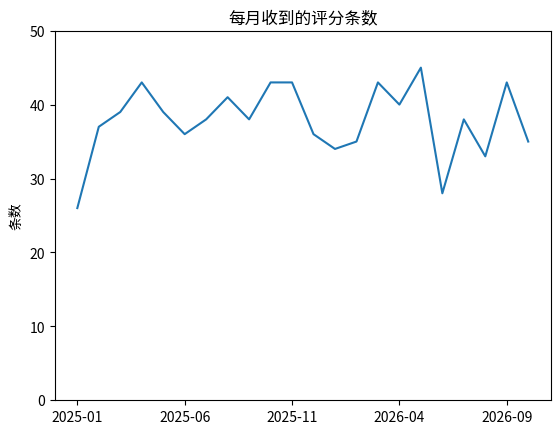

# 数据分析第 10 章：综合项目二：给书店写一份分析报告

# 前言

上一个项目，分析的是自己的钱。这一个项目，咱们换个身份：假如你是两点书店的店长，手上有两份数据，一份是书目 `books.csv` ，一份是读者评分 `book_reviews.csv` 。你想从里面看出点什么，好决定下个月该进什么书、补什么货。

和上一章不一样的是，这一次，问题要你自己来提。

学过爬虫课的童鞋，应该认得 `books.csv` ：它就是爬虫课第 9 章抓下来的那一份。你可以换成自己抓的文件，结果应该一模一样。没学过也不要紧，网页里已经准备好了。

那具体怎么做呢？步骤还是那六步，节奏也还是上一章的节奏：先提问，再检查数据，然后一个问题一个问题地回答，最后写成一份给店长看的报告。不过，这一章会在「检查」上多花一些力气。你会看到，哪怕是一个只差了 0.1 的数，背后也藏着值得弄清楚的东西。

**学这一章之前**，需要先学完 [数据分析课第 9 章](09-ledger-analysis.md) 。

# 目录

这一章会做：

- 一、提问——站在店长的角度
- 二、获取和检查——两张表对得上吗
- 三、书店里有些什么书，缺什么货
- 四、哪些书最受好评
- 五、评分的人是多了还是少了
- 六、写一份给店长的报告
- 七、常见坑
- 八、自己查一次文档——用 `pd.cut()` 给书分价位
- 九、小结与回看

做完这一章，你就独立完成了一次从提问到报告的分析，数据分析课也就学完了。

# 一、提问

当店长，最关心的是什么呢？说来说去，无非是：店里的书对不对路，该进什么、该补什么。可这句话太笼统了，没法直接算。和上一章一样，先把它拆成几个具体的问题：

| 问题 | 要算的数 | 用到的本事 |
|---|---|---|
| 1. 书店有些什么书，各是什么价位？ | 各类别的本数、价格中位数 | `groupby()` 、`agg()` |
| 2. 缺货的是哪些书？是不是受欢迎的书？ | 缺货书的类别；缺货和有货的书，评分、评分条数比一比 | 筛选、分组 |
| 3. 哪一类书、哪几本书最受好评？ | 各类别平均分；评分最高的几本 | `merge()` 、排序 |
| 4. 贵的书，评分是不是更高？ | 不同价位的平均分 | 分组，第八节用 `pd.cut()` |
| 5. 来评分的人是多了还是少了？ | 每个月的评分条数 | 字符串、画图 |

拆完了，还要反过来想一想：有哪些问题，是这两份数据**答不了**的？

- 「哪本书卖得最好？」这两份数据里没有销量。评分条数多，也许说明买的人多，可不是每个买书的人都会去打分，所以它只能算一个参考。
- 「哪类书最赚钱？」没有进价，只有售价，算不出利润。

答不了的，就不在报告里硬答。真要回答，得先去找更多的数据。

当然，这张表只是一种拆法。你当店长，也许还关心别的：老书和新书哪个评分高、作者写了好几本书的是不是更受欢迎……可以先跟着把这一章做完，再回过头来，用同样的办法回答你自己的问题。

问题有了。不过和上一章一样，动手回答之前，得先检查一下数据。

# 二、获取和检查

这一次有两张表，后面要合在一起用。所以第一件事，是检查它们对不对得上：

```python
import pandas as pd

books = pd.read_csv('books.csv')
reviews = pd.read_csv('book_reviews.csv')
print(len(books), books['id'].is_unique)
print(len(reviews), reviews['book_id'].isin(books['id']).all())
print(reviews['date'].min(), reviews['date'].max())
```

输出的结果：

```
120 True
834 True
2025-01-01 2026-11-01
```

三行输出，分别检查了三件事：

- `is_unique` ：检查这一列的值是不是都不一样。结果是 `True` ，说明书的编号没有重复，每个编号只对应一本书，可以放心地当键。
- `isin(books['id']).all()` ：检查评分表里的每个书号，是不是都在书目表里。`all()` 的意思是「全部都是 `True` 吗」。结果也是 `True` ，说明全都对得上，没有给不存在的书打的分。
- 最后一行是评分的日期范围：从 2025 年 1 月 1 日，一直记到 2026 年 11 月 1 日。

两张表对得上号，这只是第一步。书目表里还有一列 `rating` ，是书店算好的平均分；而评分表里，是一条条原始的评分。那书店算的平均分，和原始的评分对得上吗？咱们用评分表自己算一遍，再和 `rating` 对一对，把不一样的行挑出来：

```python
import pandas as pd

books = pd.read_csv('books.csv')
reviews = pd.read_csv('book_reviews.csv')
stats = reviews.groupby('book_id')['score'].agg(['count', 'mean']).reset_index()
table = books.merge(stats, left_on='id', right_on='book_id', how='left')
table['my_rating'] = table['mean'].round(1)
diff = table[table['rating'] != table['my_rating']]
print(diff[['id', 'title', 'rating', 'count', 'mean', 'my_rating']])
```

输出的结果：

```
      id           title  rating  count  mean  my_rating
2      3        早起养花     NaN    NaN   NaN        NaN
17    18        驿站笔记     3.3    4.0  3.25        3.2
21    22  轻松学网页开发     NaN    NaN   NaN        NaN
22    23      光影的秘密     NaN    NaN   NaN        NaN
41    42      月亮找朋友     NaN    NaN   NaN        NaN
45    46      看懂经济学     NaN    NaN   NaN        NaN
56    57      小熊找朋友     NaN    NaN   NaN        NaN
60    61      旧城的钟声     NaN    NaN   NaN        NaN
72    73      细胞的故事     4.3    4.0  4.25        4.2
75    76        长街旧影     NaN    NaN   NaN        NaN
87    88  人人都懂的储蓄     4.3    4.0  4.25        4.2
97    98  人人都懂的价格     3.3   12.0  3.25        3.2
113  114      版式的力量     NaN    NaN   NaN        NaN
114  115      气候的故事     NaN    NaN   NaN        NaN
117  118      光里的秘密     NaN    NaN   NaN        NaN
```

一共挑出来 15 行。仔细看，它们分成两种：

- 11 行两边都是 `NaN` ：这些是没人打过分的书。奇怪的是，`NaN` 和 `NaN` 用 `!=` 比，结果竟然是「不相等」，所以它们被挑了出来。这是 `NaN` 的一个怪脾气：它和谁都不相等，连和自己也不相等。所以这 11 本，其实是对得上的。
- 另外 4 行，是真的差了 0.1：比如书店说 3.3，我们算的是 3.2。

这 0.1 是怎么差出来的呢？看 `mean` 这一列，全是 3.25、4.25 这样的数，正好落在两个数的正中间。

问题就出在「正中间」该怎么舍入上。书店的系统用的是平常的四舍五入，3.25 就进成了 3.3。而 pandas 的 `round()` 背后用的是 numpy，numpy 的文档里写着：正好在中间的值，要舍入到最近的**偶数**，所以 3.25 变成了 3.2。[numpy.round](https://numpy.org/doc/2.0/reference/generated/numpy.round.html) 的说明里举的例子是：1.5 和 2.5，都变成 2.0。

所以，两边都没算错，只是舍入的规则不同。检查到这里，就可以放心了：两张表说的是同一回事。

你看，一个只差了 0.1 的数，追下去，就学到了 `NaN` 的怪脾气和两种舍入规则。分析之前做检查，就是为了把这种「差一点」的地方都弄清楚，免得后面的结论，建在说不清的数上。

数据检查完了，下一节就开始回答问题。

# 三、书店里有些什么书，缺什么货

先回答问题 1：书店有些什么书，各是什么价位？对每个类别，咱们想同时看几个数：有几本书、价格的中位数是多少、有几本缺货。可麻烦的是，这几个数来自不同的列，而第 6 章的 `agg(['count', 'sum'])` 只能对同一列来算。

那怎么办呢？其实 `agg()` 还有一种写法，可以给每个结果起个名字，同时说明拿哪一列、怎么算。格式是这样的：`新列名=('哪一列', '怎么算')` 。

```python
import pandas as pd

books = pd.read_csv('books.csv')
books['out'] = books['stock'] == 0
summary = books.groupby('category').agg(
    books=('id', 'count'),
    median_price=('price', 'median'),
    out_of_stock=('out', 'sum'),
)
print(summary.sort_values('median_price', ascending=False))
```

输出的结果：

```
          books  median_price  out_of_stock
category                                   
设计         15          82.5             3
编程         15          69.3             4
科普         15          65.7             1
历史         15          60.2             3
经济         15          58.4             1
小说         15          48.6             0
生活         15          47.0             1
童书         15          38.7             1
```

代码里有两处要说一下：

- `books['out']` ：库存是 0，就是缺货。比较的结果是一串 `True` 和 `False` ，`sum()` 一下，就是缺货的本数。
- `books=('id', 'count')` ：结果里叫 `books` 的这一列，数的是 `id` 列有几个值。

再看结果：8 个类别，每类各 15 本。设计类最贵，价格中位数 82.5 元；童书最便宜，38.7 元。缺货的一共 14 本，其中编程类最多，有 4 本。

知道了哪些类别缺货，接着就是问题 2：缺货的书，是不是更受欢迎？做法是把缺货和有货的书分成两组，比一比评分和评分条数：

```python
import pandas as pd

books = pd.read_csv('books.csv')
books['out'] = books['stock'] == 0
print(books.groupby('out')[['rating', 'reviews']].mean().round(2))
print(books['out'].sum())
```

输出的结果：

```
       rating  reviews
out                   
False    3.53     6.68
True     3.70     9.00
14
```

这里要说一下的只有一处：

- `[['rating', 'reviews']]` ：分组以后一次取出两列，两列一起求平均。

结果是：缺货的 14 本，平均评分 3.70，比有货的 3.53 高一点；平均有 9 条评分，而有货的只有 6.68 条。看上去，缺货的确实是更受欢迎、被买得更多的书。

所以结论是：**缺货的书偏向受欢迎的书，值得优先补货**。不过缺货的只有 14 本，这个差别有多可靠，第七节还会再说。

先做一道练习：数一数缺货的书都属于哪个类别。

# 四、哪些书最受好评

接下来是问题 3：哪一类书、哪几本书最受好评？先看类别。这个第 7 章已经算过一次，这回只看前三名：

```python
import pandas as pd

books = pd.read_csv('books.csv')
reviews = pd.read_csv('book_reviews.csv')
merged = reviews.merge(books, left_on='book_id', right_on='id')
print(merged.groupby('category')['score'].mean().round(2).sort_values(ascending=False).head(3))
```

输出的结果：

```
category
设计    3.83
编程    3.68
小说    3.59
Name: score, dtype: float64
```

设计类最受好评。上一节算过，它正好也是最贵的一类。

类别看完了，再看具体的书：把每本书的平均分，从高到低排一排。不过有个问题：只有一两个人打过分的书，平均分其实说明不了什么。所以先定一个门槛，至少要有 10 条评分，才参加排名：

```python
import pandas as pd

books = pd.read_csv('books.csv')
reviews = pd.read_csv('book_reviews.csv')
stats = reviews.groupby('book_id')['score'].agg(['count', 'mean']).reset_index()
table = books.merge(stats, left_on='id', right_on='book_id')
popular = table[table['count'] >= 10]
print(len(popular))
print(popular.sort_values('mean', ascending=False)[['title', 'category', 'count', 'mean']].head(5).round(2))
```

输出的结果：

```
44
              title category  count  mean
78   身边的通货膨胀     经济     12  4.92
100        字体入门     设计     11  4.91
40     小狐狸的冒险     童书     11  4.82
69     数字里的秘密     科普     12  4.75
0    轻松玩转自动化     编程     13  4.69
```

可以看到，有 44 本书收到了 10 条以上的评分。在它们当中，评分最高的五本，来自五个不同的类别。

这说明了一件事：类别的平均分只是一个大概，好书哪一类都有。所以店长进货的时候，既要看类别，也要看具体的书。

那为什么非要设门槛呢？不设会怎样？这正是第七节的第一个坑，到时候再细说。先做一道练习：同样设上门槛，找出平均分最低的三本书。

# 五、评分的人是多了还是少了

问题 4 要先查一查文档，留到第八节再做。这一节先回答问题 5：来评分的人是多了还是少了？

要回答它，得按月数一数评分条数。那月份从哪儿来呢？日期是 `2025-01-01` 这样的字符串，前 7 个字符就是年月。第 5 章学过 `.str` ，用它来切片也一样行：

```python
import pandas as pd

reviews = pd.read_csv('book_reviews.csv')
reviews['month'] = reviews['date'].str[:7]
monthly = reviews.groupby('month').size()
print(monthly.head(3))
print(monthly.tail(3))
```

输出的结果：

```
month
2025-01    26
2025-02    37
2025-03    39
dtype: int64
month
2026-09    43
2026-10    35
2026-11     1
dtype: int64
```

这里的 `str[:7]` ，就是对每个日期取前 7 个字符。而且 `2025-01` 这样的写法，按文字排序，正好也是按时间排序，所以不用再转成日期。

再看输出，有个地方不太对劲：最后一个月，2026 年 11 月，只有 1 条？难道是突然没人来评分了？

先别急，想一想第二节的检查结果：评分只记到 2026 年 11 月 1 日。11 月才过了一天，当然只有 1 条。所以要记住：**不完整的月份，不能和完整的月份比**。画图之前，先把它去掉：

```python
import pandas as pd
import matplotlib.pyplot as plt

reviews = pd.read_csv('book_reviews.csv')
reviews['month'] = reviews['date'].str[:7]
monthly = reviews.groupby('month').size()
monthly = monthly[monthly.index < '2026-11']

monthly.plot(title='每月收到的评分条数', ylim=(0, 50))
plt.xlabel('')
plt.ylabel('条数')
plt.show()
print(monthly.mean().round(1))
```

输出的结果：

```
37.9
```



这段代码里，要说一下的只有一处：

- `monthly.index < '2026-11'` ：索引是年月的字符串，按文字来比较，就能挑出 2026 年 11 月以前的。

再看图。纵轴从 0 开始，看得很清楚：除了第一个月和 2026 年 6 月少一些，每个月都在三四十条之间上下起伏，平均每月 38 条左右，既没有明显变多，也没有变少。

所以结论是：**来评分的人很稳定**。要是想让更多的人来评分，就得想点办法了，比如在书里夹一张请读者评分的卡片。

先做一道练习：数一数 2025 年一共收到了几条评分，平均每个月几条。

# 六、写一份给店长的报告

前面几节的发现，现在要写成报告了。不过这份报告，和上一章的不太一样：上一章的报告是写给自己看的，这一份要交给店长。店长关心的，不是你用了什么方法，而是：**看到了什么，该做什么**。

所以，这份报告分成两部分：发现和建议。而且每一条建议，都要能指回一条发现。

```python
import pandas as pd

books = pd.read_csv('books.csv')
reviews = pd.read_csv('book_reviews.csv')
books['out'] = books['stock'] == 0

stats = reviews.groupby('book_id')['score'].agg(['count', 'mean']).reset_index()
table = books.merge(stats, left_on='id', right_on='book_id')
merged = reviews.merge(books, left_on='book_id', right_on='id')
by_category = merged.groupby('category')['score'].mean().sort_values(ascending=False)
out_books = books[books['out']]
in_books = books[~books['out']]
top = table[table['count'] >= 10].sort_values('mean', ascending=False).head(3)

print('两点书店数据分析报告')
print('=' * 20)
print('【发现】')
print(f"1. 共 {len(books)} 本书，缺货 {len(out_books)} 本，其中编程类 {(out_books['category'] == '编程').sum()} 本。")
print(f"2. 缺货的书平均 {out_books['reviews'].mean():.1f} 条评分，有货的 {in_books['reviews'].mean():.1f} 条：缺的多是受欢迎的书。")
print(f"3. 评分最高的类别是{by_category.index[0]}（{by_category.iloc[0]:.2f} 分），最低的是{by_category.index[-1]}（{by_category.iloc[-1]:.2f} 分）。")
print(f"4. 10 条以上评分的书里，最受好评的是：{'、'.join(top['title'])}。")
print('【建议】')
print('1. 优先给缺货的书补货，先补编程类。（发现 1、2）')
print(f'2. 多进{by_category.index[0]}类的书，留意{by_category.index[-1]}类为什么评分偏低。（发现 3）')
print('3. 把好评的书摆在显眼的地方。（发现 4）')
print('【说明】没有销量和进价，评分条数只能大致反映受欢迎的程度。')
```

输出的结果：

```
两点书店数据分析报告
====================
【发现】
1. 共 120 本书，缺货 14 本，其中编程类 4 本。
2. 缺货的书平均 9.0 条评分，有货的 6.7 条：缺的多是受欢迎的书。
3. 评分最高的类别是设计（3.83 分），最低的是生活（3.25 分）。
4. 10 条以上评分的书里，最受好评的是：身边的通货膨胀、字体入门、小狐狸的冒险。
【建议】
1. 优先给缺货的书补货，先补编程类。（发现 1、2）
2. 多进设计类的书，留意生活类为什么评分偏低。（发现 3）
3. 把好评的书摆在显眼的地方。（发现 4）
【说明】没有销量和进价，评分条数只能大致反映受欢迎的程度。
```

代码里有两个新的写法：

- `by_category.index[0]` 是排第一的类别名，`by_category.iloc[0]` 是它的分数；`[-1]` 就是最后一个。
- `'、'.join(top['title'])` ：`join()` 是字符串的方法，能把一串字符串用前面的 `'、'` 连成一个。一列字符串也能直接交给它，这样三本书名就连成了一句。

写法说完了，再来看看这份报告本身。它有三个地方值得学：

- **发现和建议分开**。发现是数据说的，建议是你的判断。店长可以同意你的发现，却不采纳你的建议。
- **建议后面标着依据**。比如「（发现 1、2）」，店长想追问的时候，马上就知道该去看哪一条。
- **说明写在最后**。数据有什么局限，提前说清楚，总比被人问住要好。

还有一个细节。第 2 条建议说的是「留意生活类为什么评分偏低」，而不是「少进生活类」。为什么这么写呢？因为评分低的原因，数据里看不出来：也许是那几本书不好，也许是买生活类书的读者打分更严。不知道原因，就只建议去弄清楚，不替店长做决定。

报告写完了。不过回头看看这一路的分析，有几个地方很容易踩坑，下一节就来说说。

# 七、常见坑

前面第三节和第四节，都留了问题到这一节来说。这一节就把这几个坑，一个一个说清楚。

## 1、只有一两条评分的书排了第一

先回答第四节留下的问题：为什么要设「至少 10 条评分」的门槛？把门槛去掉，看看会怎样：

```python
import pandas as pd

books = pd.read_csv('books.csv')
reviews = pd.read_csv('book_reviews.csv')
stats = reviews.groupby('book_id')['score'].agg(['count', 'mean']).reset_index()
table = books.merge(stats, left_on='id', right_on='book_id')
print(table.sort_values('mean', ascending=False)[['title', 'count', 'mean']].head(5))
```

输出的结果：

```
             title  count  mean
90        气候简史      1   5.0
2         书院笔记      7   5.0
64      迟到的来信      5   5.0
68  从零开始写爬虫      3   5.0
92        看懂保险      1   5.0
```

排在前面的都是满分 5.0，可其中有两本，只有 1 条评分。一个人打了 5 分，平均就是 5 分；要是再来一个人打 1 分，平均就成了 3 分。所以，打分的人太少，平均分就很不稳。

那么，排「谁最好」之前，先想一想：每一个平均数背后，有多少个数？太少的，要么不参加排名，要么在报告里注明。门槛定多少合适呢？这没有标准答案。10 条是我们的选择，报告里要说清楚。

## 2、评分条数不是销量

第三节说，缺货的书「被买得更多」，依据是它们的评分条数多。可这其实只是一个猜测：买了书的人，不一定都会来打分；打分多，也可能是因为这本书容易引起争论。

像这样，用一个数去代替另一个拿不到的数，叫做**代理指标**。实在没有办法的时候，可以用它，但心里要清楚它只是个近似，报告里也要说明。上一节报告最后的「说明」，写的就是这件事。

## 3、组太小，差别可能只是碰巧

第三节还算出：缺货的书平均评分 3.70，有货的 3.53，差了 0.17。这个差别，靠得住吗？

要知道，缺货的只有 14 本。14 本书里，只要碰巧多了一两本高分书，平均分就能高出这么多。组越小，平均数就越容易被个别值带着跑。第 4 章说过的这个道理，在这里一样适用。

所以第三节的结论，用的是「偏向」「值得优先」，而不是「缺货的书一定更好」。数据少的时候，结论就要说得留有余地。要想更有把握，就得有更多的数据，比如再记一年。

# 八、自己查一次文档

五个问题里，还剩问题 4 没有回答：贵的书，评分是不是更高？

价格是一个个具体的数，所以最好先把它分成几个价位：40 元以下、40 到 70 元、70 元以上，再按价位分组。那用什么来分呢？第 4 章查 `value_counts(bins=...)` 的时候，顺着文档看到过 `pd.cut()` ，它就是用来把数分段的。再打开 [pandas.cut](https://pandas.pydata.org/pandas-docs/version/2.2/reference/api/pandas.cut.html) 看看。

上次用的是 `bins` ，这次留意另一个参数 `labels` 。它给每一段起名字，名字的个数要和段数一样。不写的话，每一段的名字就是 `(40, 70]` 这样的区间。

查到了，就动手试一试：

```python
import pandas as pd

books = pd.read_csv('books.csv')
books['band'] = pd.cut(books['price'], bins=[0, 40, 70, 120], labels=['40 元以下', '40～70 元', '70 元以上'])
print(books[['title', 'price', 'band']].head(3))
print(books.groupby('band', observed=True)['rating'].agg(['count', 'mean']).round(2))
```

输出的结果：

```
                title  price       band
0      轻松玩转自动化  104.4  70 元以上
1  小账本里的通货膨胀   42.7  40～70 元
2            早起养花   56.2  40～70 元
           count  mean
band                  
40 元以下     22  3.35
40～70 元     60  3.55
70 元以上     27  3.72
```

代码里有三处要说一下：

- `bins=[0, 40, 70, 120]` ：四个边界，分成三段。和第 4 章一样，每段不包括左边、包括右边。
- `labels` ：三段，就起三个名字。
- `observed=True` ：`pd.cut()` 分出来的，是一种特殊的「分类」类型。分组的时候，pandas 要你说明：没有书的价位，要不要也列出来。写 `True` 表示只列出有书的；不写的话，会冒出一条警告。

再看结果：价位越高，平均评分也越高，3.35、3.55、3.72。注意，这里的 `count` 是有评分的书的本数，没人打分的书不算在里面。

那么，价格和评分到底有没有关系呢？第 8 章的散点图告诉过我们，页数和价格没什么关系。这回不一样，三个价位的平均分一路往上，看起来是有关系的。可是差得不算大，而且两头的价位各只有二三十本书。所以结论可以写成：**贵一些的书评分略高，但差别不大**。和上一节的坑 3 一样，话要说得留有余地。

`pd.cut()` 在第 4 章就见过一面，这次又用上了它的另一个参数。文档常常就是这样：第一次查，只用到一点；下次再来，又能发现新东西。

# 九、小结与回看

这一章，咱们站在店长的角度，独立做了一次完整的分析。回头看看，每一步都做了什么：

- **提问**：把「书店怎么样」拆成五个问题，也想清楚了哪些问题这两份数据答不了。
- **检查**：先看两张表的键对不对得上；再把自己算的评分和书店的对一对，追出了 `NaN` 和谁都不相等、两种舍入规则这两件事。
- **分析**：`agg(新列名=('列', '方法'))` 一次从几列算出几个数；缺货和有货分组比较；评分设门槛再排名；`str[:7]` 取出年月，去掉不完整的月份再看趋势；`pd.cut()` 分价位。
- **报告**：给别人看的报告，发现和建议要分开，建议要标明依据，最后写清局限。
- 常见的坑有三个：样本太少的平均分不稳，排名要设门槛；评分条数只是销量的代理指标；组太小，差别可能只是碰巧。

哪里卡住了，就回去看一看：

- 合并两张表：数据分析课第 7 章
- 切片：第 3 章

到这里，数据分析课就全部学完了。

回头看看，这十章里学的，不只是 pandas 的方法。更要紧的，是那六个步骤，以及一路上反复提到的几个习惯：先把问题问具体，先看数据再动手，每算出一个数都验一验，结论只说数据撑得住的话。

方法会忘，忘了查文档就行，前面每一章都练过怎么查。而这几个习惯，不管换什么工具、分析什么数据，都用得上。

那接下来该做什么呢？最好的练习，是找一份你自己关心的数据：自己的记账本、运动记录、读书清单、班级的成绩……照着这两个项目的样子，提几个问题，把它分析一遍。
